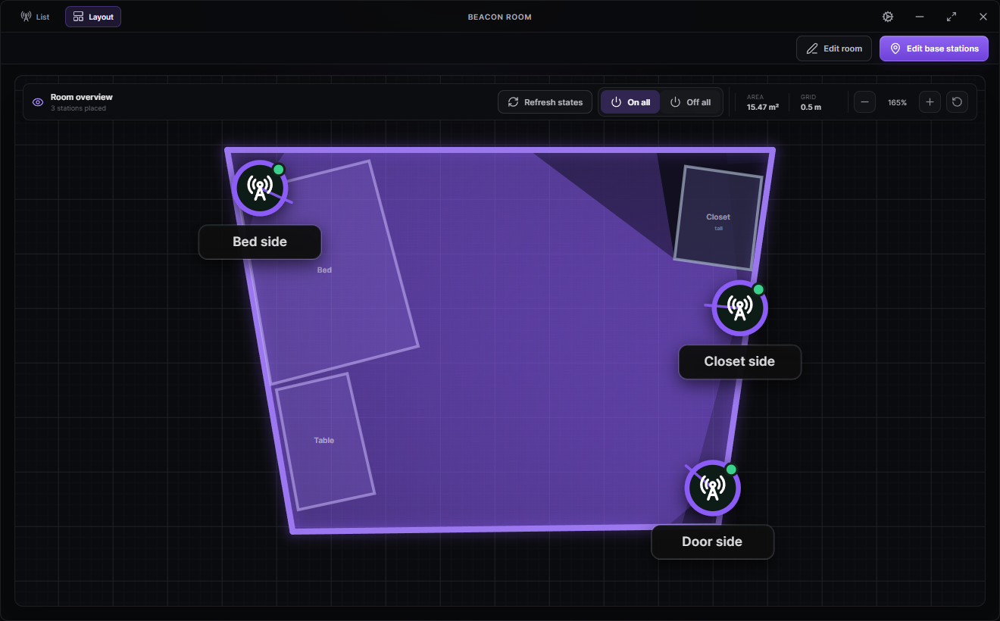

# Beacon Room

Beacon Room is a desktop companion for SteamVR Base Station 2.0 setups. It brings base-station power control and a simple room planner into one place, so it is easier to see what is installed, where it is aimed, and what its coverage should look like.



## What it does

- Finds nearby `LHB-` Base Station 2.0 devices over Bluetooth Low Energy.
- Shows stations in a compact list, with local renaming, individual power control, and `On all` / `Off all` actions.
- Lets you draw a measured room boundary with configurable grid snapping, zoom, and pan controls.
- Places base stations on the plan and lets you rotate their horizontal coverage direction.
- Visualises each powered station's 7 m planning range with a soft coverage cone. The default 160° horizontal aperture follows Valve's Base Station 2.0 specification.
- Supports named interior objects. Tall objects can show an estimated 2-D coverage shadow.
- Saves the room and known stations locally, then reopens to a clean overview of the finished layout.
- Includes light, dark, and system themes; optional tray behaviour; desktop notifications; and background status refresh.
- Can expose a local-only HTTP API for automation and smart-home integrations.

Coverage and shadows are planning aids, not a physical tracking simulation.

## Using the app

1. Open **List** and scan for nearby base stations. You can refresh their state, toggle one station, or use the bulk power buttons.
2. Open **Layout**, draw and close the room boundary, then add any furniture or obstacles.
3. Place stations, adjust their coverage direction if needed, and finish setup. The overview remains available for day-to-day control.

Bluetooth must be enabled and the computer needs a Bluetooth Low Energy adapter. The app communicates directly with the stations; do not pair them through the operating system first.

## Local API

Enable the **Local control API** in Settings to listen on `127.0.0.1:7575` by default (the port is configurable). It is intentionally limited to the local computer.

- `GET /api/v1/stations` — saved stations, including display names, IDs, and known status.
- `POST /api/v1/stations/discover` — scan and save nearby stations.
- `POST /api/v1/stations/refresh` — refresh the saved stations' statuses.
- `POST /api/v1/stations/on` and `/off` — control every saved station.
- `POST /api/v1/stations/{id}/on` and `/off` — control one station by its Beacon Room ID.

## Run locally

Install Go 1.23+ and Node.js. Then run:

```bash
git clone https://github.com/FlameInTheDark/steamvr-room.git
cd steamvr-room
go run github.com/wailsapp/wails/v2/cmd/wails@v2.12.0 dev
```

If you prefer a globally installed CLI, follow the [Wails installation guide](https://wails.io/docs/gettingstarted/installation/) and use `wails dev` instead.

For a production Windows executable:

```bash
go run github.com/wailsapp/wails/v2/cmd/wails@v2.12.0 build
```

The build is written to `build/bin/BeaconRoom.exe`.

## Development checks

```bash
cd frontend
npm ci
npm test
npm run build

cd ..
go vet ./...
go test -race ./...
```

## Releases

Pushing conventional commits to `main` starts the release workflow after the checks pass. `feat:` releases a minor version, `fix:` releases a patch version, and a breaking-change commit releases the next major version. A successful release automatically builds and attaches both the standalone `BeaconRoom-<version>-windows-amd64.exe` and the NSIS `BeaconRoom-<version>-windows-amd64-installer.exe` to the GitHub release.

Valve's Base Station 2.0 coverage reference: [7 m range, 160° × 115° field of view](https://www.valvesoftware.com/en/index/base-stations).
